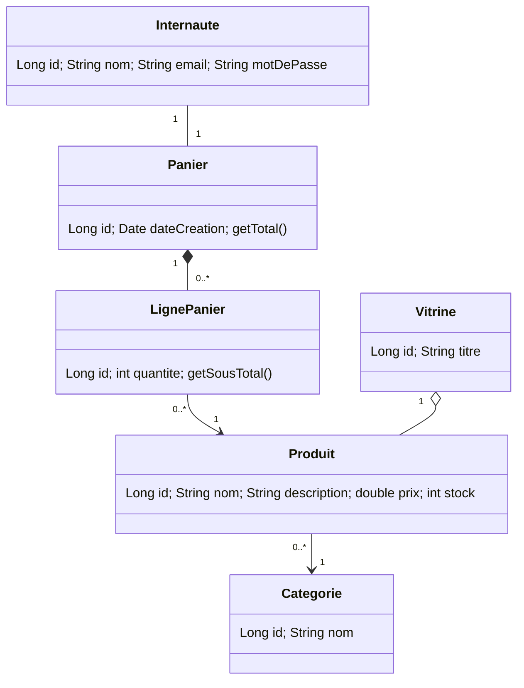

# Mini-rapport – Atelier JSF + JPA (site e-commerce)

Université Abdelmalek Essaadi – FST Tanger – LSI – JEE

## 1. Objectif
Maîtriser JPA (EclipseLink) et JSF (Mojarra) via une application e-commerce centrée sur
la **vitrine**, le **panier** et l'**internaute**.

## 2. Étape 1 – Diagramme de classes

## 3. Étape 2 – Projet Maven
Projet `war` (Servlet 4.0). Dépendances dans [pom.xml](pom.xml) : mysql-connector-java 8.0.12,
JPA/EclipseLink 2.7.5 (API `javax.persistence` 2.2.1, requise par EclipseLink 2.7.5 – la 2.0.0 du sujet est incompatible),
jsf-api et jsf-impl 2.2.20, servlet-api 4.0.0 (`provided`).

## 4. Étape 3 – Couche modèle / persistance
- Entités JPA : `Internaute`, `Panier`, `LignePanier`, `Produit`, `Categorie`, `Vitrine` (package `model`).
- [persistence.xml](src/main/resources/META-INF/persistence.xml) : unité `ecommercePU`, `RESOURCE_LOCAL`,
  `eclipselink.ddl-generation=create-or-extend-tables` → les tables sont **générées dans MySQL** au 1er accès ;
  la base `ecommerce_db` est créée via `createDatabaseIfNotExist=true`.
- `JPAUtil` fournit l'`EntityManagerFactory` ; les `service/*` utilisent des transactions JPA
  (`begin/commit/rollback`).

## 5. Étape 4 – Beans JSF
| Gestion | Bean | Portée |
|---|---|---|
| Internaute | `InternauteBean` (inscription, connexion, déconnexion) | Session |
| Vitrine | `VitrineBean` (affichage produits, données de démo) | View |
| Panier | `PanierBean` (ajouter, retirer, vider, total) | Session |

Pages : `vitrine.xhtml`, `connexion.xhtml`, `inscription.xhtml`, `panier.xhtml`, `menu.xhtml`.

## 6. Exécution
1. MySQL démarré (`root`, mot de passe vide – modifiable dans `persistence.xml`).
2. `mvn clean package` → `target/ecommerce.war`.
3. Déployer sur Tomcat 9 (javax.*, pas Tomcat 10) → http://localhost:8080/ecommerce/

## 7. Conclusion
L'atelier met en œuvre le mapping objet-relationnel (1-1, 1-N, N-1), les transactions JPA
et le cycle de vie des managed beans JSF.
